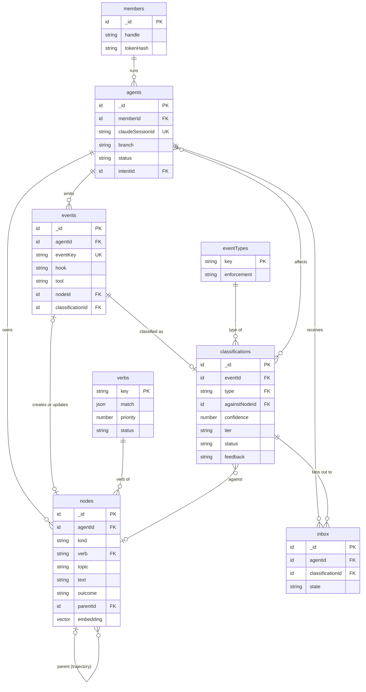
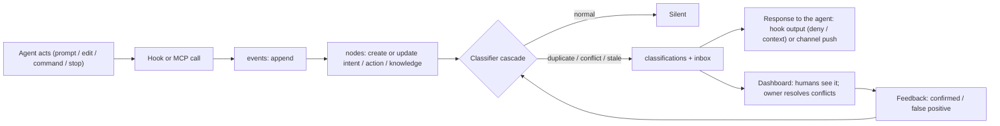
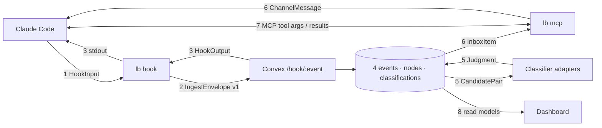

# Little Brother — Implementation Plan (Cal Hacks 13.0)

> When a team runs several coding agents on the same codebase, the agents can't see each other. They redo each other's work, retry approaches a teammate's agent already proved don't work, and build incompatible versions of the same thing. Users wait, tokens burn, and the damage shows up at `git push`.
> Little Brother classifies every agent action as it happens and steers the agent before the waste occurs.

**Deadline:** Sun Oct 25, 9:00 AM. **Freeze:** Sun 3:00 AM.

---

## 1. Problem and pitch

| Pain              | What happens today                                                                             | What Little Brother does                                                          | Event type  |
| ----------------- | ---------------------------------------------------------------------------------------------- | --------------------------------------------------------------------------------- | ----------- |
| Duplicate work    | Two agents build the same thing; one copy is thrown away at merge                              | Stops the second agent at the edit and points it to the existing work             | `duplicate` |
| Repeated failure  | An agent spends 10 minutes on an approach another agent already proved fails                   | Injects "this was tried, it failed because X, what worked was Y" before it starts | `stale`     |
| Incompatible work | Two agents implement the same topic differently; each passes its own tests; integration breaks | Blocks further work on that topic, shows both sides, and the owner decides        | `conflict`  |
| Everything else   | —                                                                                              | Stays silent                                                                      | `normal`    |

**Selling point:** fewer wasted tokens and less waiting. We measure it: tokens and minutes saved per catch, catches before push, and classifier precision.

---

## 2. Core model

### Node kinds: what the shared graph is made of

| Kind        | Meaning                                                                                                               | Created from                                                                     |
| ----------- | --------------------------------------------------------------------------------------------------------------------- | -------------------------------------------------------------------------------- |
| `intent`    | What an agent is trying to do, and how. Can be broad ("build checkout") or narrow ("add CORS middleware to the API"). | `UserPromptSubmit`; refined when the agent's plan or approach changes            |
| `action`    | A real change or command: an edit, a write, a test run, a commit                                                      | `PreToolUse` / `PostToolUse`                                                     |
| `knowledge` | A fact about the codebase, including **outcomes**: "approach X failed because Y; Z worked"                            | Distilled at `Stop` from the trajectory; MCP `post_knowledge`; human resolutions |

A **trajectory** is one intent plus its actions, ending with an outcome (`succeeded`, `failed`, `superseded`). Failed trajectories become `knowledge` nodes. That memory is what powers `stale`.

### Compact signatures

Every node also carries a one-line signature built from a fixed vocabulary: `VERB topic target → OUTCOME`. This is structured fields, not a language to parse. Agents never write it; Little Brother derives it from hooks and shows it back in warnings.

```
EXPLORE  api.cors   src/server.ts
EDIT     api.cors   src/server.ts  cors(origin:*, creds)  → FAIL browser-rejects
EDIT     api.cors   web/vite.config.ts  proxy /api        → OK
DECIDE   auth.mech  jwt-bearer                            → APPROVED
```

| Verb      | Derived from (no model call)                                   |
| --------- | -------------------------------------------------------------- |
| `PLAN`    | Prompt, or plan text in the assistant message                  |
| `EXPLORE` | Read / Grep / Glob                                             |
| `EDIT`    | Edit / Write / MultiEdit                                       |
| `RUN`     | Bash, other than tests                                         |
| `TEST`    | Bash matching the repo's test/build commands                   |
| `FIX`     | An edit following a failed `RUN`/`TEST` in the same trajectory |
| `REVERT`  | An edit restoring a file's earlier content                     |
| `DECIDE`  | A topic choice, from MCP or a human resolution                 |
| `LEARN`   | Distilled knowledge at `Stop`                                  |

Only `topic` needs the classifier.

**The vocabulary is data, not code.** The verbs above are the seed rows of a `verbs` table. Each row holds the verb's matching rules: a regex on the tool name, a regex on the command or path, the previous verb, and the outcome. A pure function in `core` evaluates the rows by priority. That gives three ways to grow the vocabulary:
- **New verb:** insert a row (e.g. `DEPLOY` for `vercel|wrangler deploy`, `MIGRATE` for `prisma migrate`). No schema change, no redeploy. Signatures pick it up on the next event.
- **New tools:** other MCP servers' tools map by pattern (`^mcp__github__` → `RUN`).
- **Unknown actions** get `ACT`, so nothing is dropped. A daily cron clusters frequent `ACT` signatures and asks the judge to propose a verb plus a matching rule. The proposal is saved as `status: "proposed"` and goes live after one click on the dashboard.

Verbs are never deleted or renamed in place, because old signatures keep pointing to them. Retire one by lowering its priority.

**Why it matters:**
- Exact rules match on fields. For example, "same topic, an `EDIT` like one that ended in `FAIL`" is a stale check with no embedding call.
- Embedding normalized signatures instead of raw prompts makes similar intents phrased differently land closer together.
- A failed trajectory injects as about three short lines instead of a paragraph.
- Graph nodes read at a glance.
- Patterns the judge confirms promote cleanly to rules.

### Event types: what the classifier outputs

| Type        | Definition                                                                                                        | Default enforcement                                                                                  |
| ----------- | ----------------------------------------------------------------------------------------------------------------- | ---------------------------------------------------------------------------------------------------- |
| `conflict`  | Another agent is working on the same topic with a different, incompatible implementation that already exists      | **Block** edits on that topic until the owner resolves it; notify both sides                         |
| `duplicate` | The same task or change is already done or in progress by another agent                                           | **Block** the duplicating edit; point to the existing work                                           |
| `stale`     | The agent is following a reasoning path that has already been classified as failed, by any agent including itself | **Warn**: inject the failure and what worked. Block only an exact repeat of a known-failing command. |
| `normal`    | No overlap                                                                                                        | Silent                                                                                               |

Internally the classifier uses eight finer relations (e.g. `textual_conflict`, `semantic_conflict`, `repeats_failure`) and four actions (`ignore`, `warn`, `serialize`, `block`) that roll up to these four types (§4). An intent-level duplicate only warns. Two agents creating the same file is a `textual_conflict` and is denied at the edit.

### The tables (Convex)

These are your three tables (activity, event types, agents), plus the three tables the workflow needs to run.

| Table             | Role                                                                                                            | Points to                      |
| ----------------- | --------------------------------------------------------------------------------------------------------------- | ------------------------------ |
| `agents`          | One row per Claude Code session, on any machine or account                                                      | member, current intent node    |
| `events`          | **Activity**: an append-only log of every hook and MCP call                                                     | agent, node, classification    |
| `nodes`           | The graph: knowledge, intent, action, each with an embedding                                                    | agent, parent intent           |
| `eventTypes`      | Lookup of the four types and their enforcement policy                                                           | —                              |
| `classifications` | One classifier verdict: event → type, against which earlier node, which agents are affected, why, how confident | event, eventType, node, agents |
| `inbox`           | What each agent still needs to be told, and its delivery state                                                  | agent, classification          |



```ts
// packages/backend/convex/schema.ts
import { defineSchema, defineTable } from "convex/server";
import { v } from "convex/values";

const typeKey = v.union(
  v.literal("conflict"),
  v.literal("stale"),
  v.literal("duplicate"),
  v.literal("normal"),
);

export default defineSchema({
  members: defineTable({
    name: v.string(),
    handle: v.string(),
    color: v.string(),
    tokenHash: v.string(),
    revoked: v.boolean(),
  }).index("by_token", ["tokenHash"]),

  agents: defineTable({
    memberId: v.id("members"),
    claudeSessionId: v.string(),
    machine: v.string(),
    repo: v.string(),
    branch: v.string(),
    status: v.union(v.literal("active"), v.literal("idle"), v.literal("offline")),
    intentId: v.optional(v.id("nodes")),
    lastSeenAt: v.number(),
  })
    .index("by_session", ["claudeSessionId"])
    .index("by_status", ["status"]),

  events: defineTable({
    agentId: v.id("agents"),
    eventKey: v.string(), // idempotency
    source: v.union(v.literal("hook"), v.literal("mcp"), v.literal("verify")),
    hook: v.string(),
    tool: v.optional(v.string()),
    files: v.array(v.string()),
    summary: v.string(),
    payload: v.any(),
    nodeId: v.optional(v.id("nodes")),
    classificationId: v.optional(v.id("classifications")),
    tokens: v.optional(v.number()), // from transcript usage, for savings metrics
    at: v.number(),
  })
    .index("by_key", ["eventKey"])
    .index("by_agent_time", ["agentId", "at"]),

  nodes: defineTable({
    agentId: v.id("agents"),
    kind: v.union(v.literal("knowledge"), v.literal("intent"), v.literal("action")),
    verb: v.string(), // key in `verbs`; unmatched actions get "ACT"
    text: v.string(), // compact signature (§2); what gets embedded
    topic: v.optional(v.string()), // e.g. "auth.mechanism", "api.cors"
    files: v.array(v.string()),
    parentId: v.optional(v.id("nodes")), // action/knowledge → intent (the trajectory)
    outcome: v.union(v.literal("open"), v.literal("succeeded"), v.literal("failed"), v.literal("superseded")),
    signature: v.optional(v.string()), // hash of a normalized command or edit, for exact repeats
    embedding: v.optional(v.array(v.float64())),
    at: v.number(),
  })
    .index("by_agent", ["agentId", "at"])
    .index("by_topic", ["topic"])
    .index("by_signature", ["signature"])
    .vectorIndex("by_embedding", {
      vectorField: "embedding",
      dimensions: 768,
      filterFields: ["kind", "outcome", "topic"],
    }),

  verbs: defineTable({
    // verb registry; add a row to add a verb
    key: v.string(),
    description: v.string(),
    match: v.array(
      v.object({
        // first matching rule across all verbs wins (by priority)
        tool: v.optional(v.string()), // regex on tool_name, e.g. "^(Read|Grep|Glob)$", "^mcp__github__"
        input: v.optional(v.string()), // regex on the command/path, e.g. "\\b(vitest|pytest|jest)\\b"
        after: v.optional(v.string()), // previous verb in the trajectory, e.g. FIX = EDIT after a failed TEST
        outcome: v.optional(v.string()), // ok | fail
      }),
    ),
    priority: v.number(),
    status: v.union(v.literal("active"), v.literal("proposed")),
  }).index("by_key", ["key"]),

  eventTypes: defineTable({
    key: typeKey,
    enforcement: v.union(v.literal("block"), v.literal("warn"), v.literal("silent")),
    description: v.string(),
  }).index("by_key", ["key"]),

  classifications: defineTable({
    eventId: v.id("events"),
    type: typeKey,
    relation: v.string(), // fine label (§4) that rolls up to `type`
    direction: v.union(v.literal("new_needs_other"), v.literal("other_needs_new"), v.literal("none")),
    action: v.union(v.literal("ignore"), v.literal("warn"), v.literal("serialize"), v.literal("block")),
    againstNodeId: v.optional(v.id("nodes")), // the earlier work this collides with
    agentIds: v.array(v.id("agents")), // everyone affected
    reason: v.string(),
    evidence: v.array(v.string()),
    confidence: v.number(),
    retrievalScore: v.number(),
    source: v.union(v.literal("rule"), v.literal("pair_model"), v.literal("llm"), v.literal("fallback")),
    outcome: v.optional(v.string()), // joined later: merge_conflict, clean_merge, human_override, …
    status: v.union(v.literal("open"), v.literal("resolved"), v.literal("dismissed")),
    resolution: v.optional(v.string()),
    feedback: v.optional(v.union(v.literal("confirmed"), v.literal("false_positive"), v.literal("ignored"))),
    at: v.number(),
  })
    .index("by_status", ["status"])
    .index("by_against", ["againstNodeId"]),

  inbox: defineTable({
    agentId: v.id("agents"),
    classificationId: v.id("classifications"),
    text: v.string(),
    state: v.union(v.literal("queued"), v.literal("delivered"), v.literal("acked"), v.literal("applied")),
    attempts: v.number(),
    at: v.number(),
  }).index("by_agent_state", ["agentId", "state"]),
});
```

The 768 embedding dimensions are a config value. They must match the embedder chosen in M0.

---

## 3. Workflow



1. **An agent does something.** Claude Code fires a hook (prompt, edit, command, stop) or the agent calls an MCP tool.
2. **Log it.** The event is appended to `events` (deduplicated by `eventKey`).
3. **Map it to a node.** A prompt becomes an `intent`, an edit or command becomes an `action` under the current intent, and a finished turn is distilled into `knowledge` with its outcome.
4. **Classify it.** The cascade (§4) checks the new node against other agents' activity and past outcomes, then writes a `classifications` row pointing to the `eventTypes` row, the earlier node it collides with, and the affected agents.
5. **Respond.** The verdict goes back in the same hook response (deny or context). Affected _other_ agents get an `inbox` row and a channel push.
6. **Learn.** Agent acks, human confirms or dismisses, and later test outcomes are recorded as feedback that tunes the classifier (§5).

### Anatomy of one event

Joshua's agent tries to create the users table that Noah's agent is already writing.

**1. Claude Code → `lb` (hook stdin)**
```json
{
  "session_id": "9f1c2a",
  "transcript_path": "~/.claude/projects/lb-demo-shop/9f1c2a.jsonl",
  "cwd": "/Users/joshua/lb-demo-shop",
  "hook_event_name": "PreToolUse",
  "tool_name": "Write",
  "tool_input": {
    "file_path": "/Users/joshua/lb-demo-shop/db/schema/users.ts",
    "content": "export const users = pgTable(\"users\", { … })"
  },
  "tool_use_id": "toolu_01AbC"
}
```

**2. `lb` → Convex: `POST /hook/PreToolUse` with `Authorization: Bearer <member token>`**
```json
{
  "v": 1,
  "eventKey": "sha1(9f1c2a|PreToolUse|toolu_01AbC)",
  "hook": "PreToolUse",
  "session": {
    "claudeSessionId": "9f1c2a",
    "repo": "lb-demo-shop",
    "branch": "joshua/checkout",
    "machine": "joshua-mbp"
  },
  "tool": "Write",
  "files": ["db/schema/users.ts"],
  "preview": "export const users = pgTable(\"users\", { … })",
  "at": 1792807023000
}
```
`preview` is capped at 40 lines: a diff hunk for edits, the command for Bash. Full file contents and transcripts never leave the machine.

**3. Stored**
```jsonc
// events
{ "agentId": "joshua#1", "eventKey": "…", "hook": "PreToolUse", "tool": "Write", "files": ["db/schema/users.ts"], "nodeId": "n_88", "classificationId": "c_12" }
// nodes
{ "_id": "n_88", "kind": "action", "verb": "EDIT", "topic": "db.users", "files": ["db/schema/users.ts"],
  "text": "EDIT db.users db/schema/users.ts create users table", "parentId": "n_80 (intent: build the checkout backend)", "outcome": "open" }
// classifications
{ "_id": "c_12", "type": "duplicate", "againstNodeId": "n_41 (Noah: EDIT db.users db/schema/users.ts)", "agentIds": ["joshua#1", "noah#1"],
  "reason": "db.users is owned by Noah and his agent is writing it now", "confidence": 0.98, "tier": "rules", "status": "open" }
```

**4. Convex → `lb` → Claude Code (stdout)**
```json
{
  "hookSpecificOutput": {
    "hookEventName": "PreToolUse",
    "permissionDecision": "deny",
    "permissionDecisionReason": "[little-brother] duplicate · db.users is owned by Noah (agent active, 2m ago). Import User from src/contracts/user.ts instead of creating db/schema/users.ts."
  }
}
```

### Data contracts



Each contract is a zod schema in `packages/core`, the single source of truth. Convex validators mirror them, either generated with `convex-helpers`' zod support (check in M0) or kept in sync by a test.

| #   | Contract                          | Between                                                              | File                         |
| --- | --------------------------------- | -------------------------------------------------------------------- | ---------------------------- |
| 1   | `HookInput`                       | Claude Code → `lb`                                                   | `core/hooks.ts`              |
| 2   | `IngestEnvelope` v1               | `lb` → Convex `/hook/:event`                                         | `core/ingest.ts`             |
| 3   | `HookOutput`                      | Convex → `lb` → Claude Code stdout                                   | `core/hooks.ts`              |
| 4   | `Event`, `Node`, `Classification` | Convex tables                                                        | `convex/schema.ts`           |
| 5   | `CandidatePair`, `Judgment`       | Backend ↔ classifier adapters (LLM output parsed against `Judgment`) | `core/classify/types.ts`     |
| 6   | `InboxItem`, `ChannelMessage`     | Convex → `lb mcp` → session                                          | `core/inbox.ts`              |
| 7   | MCP tool args and results         | Agent ↔ `lb mcp`                                                     | `core/mcp.ts`                |
| 8   | Dashboard read models             | Convex queries → web                                                 | `convex/*` return validators |

Rules:
- The envelope carries `v`.
- Changes during the hackathon are additive only: new optional fields, never renames.
- Every contract has a fixture in `fixtures/contracts/` that a test validates.
- Contracts 1–3 land in M0 so all three of us build against them from the start.

**Agents never have to remember to check.** Every hook already queries the agent's inbox, so the "keep checking the events table" step is automatic. Channels push urgent items into a session even while it's idle.

---

## 4. Classifier pipeline

Based on the team's classifier spec (v0.1), with four changes so it fits this product:
1. A failure-memory path for `stale`.
2. Two-level labels.
3. Normalization runs on the developer's machine.
4. Actions are mapped to what Claude Code can actually do.

For every new event, the classifier answers one question: _given what everyone else is doing and what has already failed, is this safe to proceed, and if not, why and with whom?_ It detects and recommends. It never resolves anything automatically.

```
new event (intent or edit)
   │
   ▼
1. Normalize        → structured event: agent, intent, touches (path, symbol, op, lines), references   [on the dev machine]
2. Find candidates  → top-k related active events + matching failed knowledge
3. Exact checks     → rules R1–R10 settle what they can
4. Pair model       → (roadmap) fast learned labeler
5. LLM judge        → only unsettled, low-confidence or severe pairs
   │
   ▼
6. Decide & emit    → one judgment per pair + worst_action rollup → hook response / inbox / dashboard
7. Log              → every judgment stored, later joined with real outcomes
```

Each stage can settle a pair early, so the common case stays cheap. **Similarity only retrieves candidates; it never decides a verdict**, because it can't tell "add X" from "remove X".

### Labels: fine relations roll up to the four event types

The classifier works with fine-grained relations internally. The dashboard, enforcement and pitch use the four event types from §2.

| Relation               | Meaning                                   | Example                                                                         | Direction | Type        |
| ---------------------- | ----------------------------------------- | ------------------------------------------------------------------------------- | --------- | ----------- |
| `independent`          | No meaningful interaction                 | Docs edit vs DB migration                                                       | —         | `normal`    |
| `overlap_compatible`   | Same area, no problem                     | Two agents add separate functions to `utils.ts`                                 | —         | `normal`    |
| `duplicate`            | Same work done twice                      | Both agents "add retry to the HTTP client"                                      | —         | `duplicate` |
| `textual_conflict`     | Git can't merge them                      | Both create `db/schema/users.ts`                                                | —         | `conflict`  |
| `semantic_conflict`    | Merges cleanly, breaks behavior           | A changes `pay(amount)` → `pay(amount, currency)`; B adds `pay(amount)` callers | yes       | `conflict`  |
| `intent_contradiction` | Goals pull in opposite directions         | A removes legacy auth; B extends it                                             | —         | `conflict`  |
| `ordering_dependency`  | One must land before the other            | B uses `User.role`, which A is creating                                         | yes       | `conflict`  |
| `repeats_failure`      | Follows a path already recorded as failed | Ash plans CORS middleware that Noah's agent proved fails                        | yes       | `stale`     |

Directional relations record `new_needs_other` or `other_needs_new`.

### Actions, mapped to Claude Code

| Action      | Meaning                    | How it reaches the agent                                                 |
| ----------- | -------------------------- | ------------------------------------------------------------------------ |
| `ignore`    | No signal                  | Nothing                                                                  |
| `warn`      | Notify; work continues     | `additionalContext` on the next hook, or a channel push                  |
| `serialize` | One side lands first       | `PreToolUse` deny: "X lands first; build on it or work on Y meanwhile"   |
| `block`     | Stop until a human decides | `PreToolUse` deny on that topic + `Stop` block + dashboard resolve panel |

### Step 1 · Normalize (runs in the connector)

The backend never sees the code, and the agents are on different machines, so normalization runs locally in `lb hook`, where the code lives. Only names, paths and line ranges are sent.
- **Edits:** `PreToolUse` gives the exact edit (`old_string`/`new_string` or full content) before it's written. Parse it into `touches[]` (path, symbol, op, lines). The op is one of `create`, `delete`, `write`, `rename` or `signature_change`, and `references[]` lists the symbols used in the changed region.
  - For v0, symbols come from the TypeScript compiler API, covering exports, imports and function signatures. Other languages fall back to file-level touches.
- **Intents:** the prompt plus any paths named in plan text. These are marked low confidence because plans are often wrong about scope.
- Generated, lock and vendored files are dropped or tagged, using a default list plus `.littlebrother.json`.
- An edit that follows its own intent links back to it, so the pair is re-classified instead of duplicated.
- **Failure handling:** if symbol mapping fails, keep the file-level touch. If required fields are missing, reject with a reason; never guess.
- **Budget:** < 50 ms, inside the 2 s hook timeout.

### Step 2 · Find candidates

Gather candidates from several signals, merge and score them, and keep the top-k (default 10). **Anything with a path or symbol overlap is always kept**, regardless of k.

| Signal                                                                                  | Finds                                     | Weight           |
| --------------------------------------------------------------------------------------- | ----------------------------------------- | ---------------- |
| Same path mutated by both                                                               | Textual conflicts, overlaps               | 1.0              |
| Same symbol touched by both                                                             | Textual and semantic conflicts            | 1.0              |
| One mutates a symbol the other references                                               | Semantic conflicts, ordering              | 0.9              |
| Same topic (topic map)                                                                  | Contract conflicts                        | 0.9              |
| Intent similarity (Convex vector index)                                                 | Duplicates, contradictions                | 0.8 × similarity |
| **Failed knowledge** matching by signature or similarity, **outside the active window** | `repeats_failure`                         | 0.9              |
| Same intent / subagents of one session                                                  | Expected overlap (lowers false positives) | annotate only    |

Rules:
- An agent is excluded from **conflict and duplicate** checks against itself, but **not** from failure memory. An agent repeating its own failure after context compaction should be caught.
- "Active" means until done + 30 min.
- Every candidate records why it was retrieved; that becomes evidence.
- **Budget:** < 50 ms for ~100 active events. If the embedder is down, fall back to lexical match.

### Step 3 · Exact checks

| #   | Condition                                                                        | Relation              | Conf. | Settles?                                                           |
| --- | -------------------------------------------------------------------------------- | --------------------- | ----- | ------------------------------------------------------------------ |
| R1  | Both mutate the same path with overlapping lines (same base)                     | `textual_conflict`    | 0.95  | yes                                                                |
| R2  | Both `create` the same path or symbol                                            | `textual_conflict`    | 0.95  | yes                                                                |
| R3  | `git merge-tree` dry run between the branches conflicts                          | `textual_conflict`    | 0.99  | yes, **in `lb verify` only** (branches live on different machines) |
| R4  | One deletes or renames what the other writes or references                       | `semantic_conflict`   | 0.90  | yes                                                                |
| R5  | One changes the signature of a symbol the other calls                            | `semantic_conflict`   | 0.85  | yes                                                                |
| R6  | One creates a symbol the other references                                        | `ordering_dependency` | 0.80  | yes                                                                |
| R7  | Both mutate the same symbol, lines unknown                                       | —                     | —     | hint                                                               |
| R8  | Same file, disjoint ranges                                                       | —                     | —     | hint: likely compatible                                            |
| R9  | Only overlap is a hot or generated file                                          | —                     | —     | hint: low signal                                                   |
| R10 | Exact match with a failed action's `signature` (same normalized command or edit) | `repeats_failure`     | 0.95  | yes                                                                |

When several settling rules fire, the most severe wins and all evidence is attached. Hints are passed on as features and evidence. **Budget:** < 20 ms per pair.

### Step 4 · Pair model (roadmap)

Skipped in v0: unsettled pairs go straight to the judge, and every judge verdict is logged as a label. In v1, a cross-encoder (ModernBERT / DeBERTa-v3 / UniXcoder class) is trained on those labels plus outcomes as an 8-way classifier with a direction head, running in about 10 ms on CPU. It escalates to the judge when:
- confidence < 0.7, or
- the relation is severe and confidence < 0.9, or
- the top two classes are within 0.15.

v2 adds graph features. This is the "distilled judge" step of the fine-tuning roadmap (§14).

### Step 5 · LLM judge

The `Judge` adapter (Gemini Flash by default, Claude `claude-opus-5-5` at low effort as the alternative) returns structured output, validated against the schema:

```json
{
  "relation": "...",
  "direction": "none",
  "confidence": 0.0,
  "rationale": "1–3 sentences citing specific symbols or lines"
}
```

The prompt contains:
- label definitions with one example each
- both events in compact signature form
- hints and retrieval reasons
- 3–5 nearest confirmed or dismissed past judgments (§5)

**Limits:** max 5 calls per event, highest retrieval score first, plus a global rate limit and a daily cost cap. On timeout, refusal, schema failure or an exhausted budget, the pair gets a `fallback` judgment with the hints as evidence. The model's confidence is treated as a hint until it's calibrated against outcomes.

**Latency:** 1–3 s, always async. Intent events are judged right after `UserPromptSubmit`, so verdicts are usually stored before the first edit. Edit verdicts that arrive later are delivered at the next hook or by channel.

### Step 6 · Decide and emit

| Relation                            | Action at ≥ threshold                  | Threshold | Below threshold |
| ----------------------------------- | -------------------------------------- | --------- | --------------- |
| `independent`, `overlap_compatible` | ignore                                 | —         | ignore          |
| `duplicate`                         | warn                                   | 0.70      | ignore          |
| `textual_conflict`                  | serialize                              | 0.80      | warn            |
| `semantic_conflict`                 | block                                  | 0.85      | warn            |
| `intent_contradiction`              | block                                  | 0.80      | warn            |
| `ordering_dependency`               | serialize (dependent side)             | 0.70      | warn            |
| `repeats_failure`                   | warn (serialize for R10 exact repeats) | 0.75      | ignore          |
- **Fallback:** `overlap_compatible` at 0.3 if hints exist, otherwise `independent` at 0.5.
- **Plans never block:** actions for `intent` events are capped at `serialize`.
- **De-duplication:** an open judgment for the same pair and relation re-alerts only when severity rises.
- **Rollup:** `worst_action` across all judgments decides the hook response.
- **Demo mapping:** the users table is R2, so `textual_conflict` → serialize → denied at the edit, shown as `duplicate`-style work on the dashboard. CORS is `repeats_failure` → warn. JWT vs cookie is `intent_contradiction` → block → owner decides.

### Step 7 · Log and learn

Every judgment is logged, including `ignore`s, with both event snapshots, the hints and the source. Outcomes are joined in later:

| Outcome                                          | Detected by                                     | Label meaning                        |
| ------------------------------------------------ | ----------------------------------------------- | ------------------------------------ |
| `merge_conflict`                                 | `lb verify` merge fails                         | Confirms textual conflict            |
| `post_merge_test_failure`                        | Each branch passed alone; the merged test fails | Strong semantic-conflict label       |
| `revert`                                         | Change reverted within the session or N days    | Weak conflict label                  |
| `clean_merge`                                    | Merged and tests stayed green                   | Evidence for independent/compatible  |
| `human_override` / `human_confirmed`             | Dashboard dismiss / act                         | False positive / true positive       |
| `ignored_then_failed` / `ignored_then_succeeded` | Agent ignored a stale warning                   | Confirms / refutes `repeats_failure` |

These labels drive §5 and the training export for the v1 pair model. LLM-only labels are flagged so they can be weighted down.

### Re-classification triggers

Re-run steps 2–6 for an event when any of these happen:
- an intent becomes an edit
- the edit footprint changes materially
- a related event finishes (a `serialize` can release)
- the base revision changes
- a decision is approved or superseded

### Interfaces

```ts
// packages/core/src/classify/types.ts
export type Relation =
  | "independent"
  | "overlap_compatible"
  | "duplicate"
  | "textual_conflict"
  | "semantic_conflict"
  | "intent_contradiction"
  | "ordering_dependency"
  | "repeats_failure";
export type Judgment = {
  otherNodeId: string;
  relation: Relation;
  direction: "new_needs_other" | "other_needs_new" | "none";
  confidence: number;
  evidence: string[];
  action: "ignore" | "warn" | "serialize" | "block";
  source: "rule" | "pair_model" | "llm" | "fallback";
  retrievalScore: number;
  latencyMs: number;
};
export interface Rule {
  id: string;
  check(pair: CandidatePair): Judgment | Hint | null;
}
export interface Embedder {
  embed(texts: string[]): Promise<number[][]>;
}
export interface Judge {
  judge(pair: CandidatePair, hints: Hint[]): Promise<Judgment | null>;
}
```

`CLASSIFIER_EMBEDDER` and `CLASSIFIER_JUDGE` select the adapters in `convex/classify/adapters/`. Confirm the Gemini model IDs and embedding size in M0.

### Evaluation targets

| Metric                                                        | Target                                                                                   |
| ------------------------------------------------------------- | ---------------------------------------------------------------------------------------- |
| Precision of `block` + `serialize`                            | ≥ 0.85; `block` turns on per relation only after it clears this in warn-only shadow mode |
| Recall on real conflicts (`lb verify` merge or test failures) | ≥ 0.80                                                                                   |
| Candidate recall (real conflicts present after step 2)        | ≥ 0.95                                                                                   |
| `PreToolUse` p95, excluding async judge                       | < 150 ms                                                                                 |
| Judge calls per event                                         | < 1 on average                                                                           |
| Calibration error (ECE)                                       | < 0.1 once outcomes exist                                                                |

### Hackathon cut (v0)

| Build now                                                          | Roadmap                                            |
| ------------------------------------------------------------------ | -------------------------------------------------- |
| Step 1: paths + TS compiler symbols (exports, imports, signatures) | tree-sitter/LSP for all languages, full call graph |
| Step 2: path, symbol, topic, embeddings, failed knowledge          | Multi-hop reference-graph neighbours               |
| Rules R1, R2, R4, R5, R6, R10                                      | R3 live (stays in `lb verify`)                     |
| Step 5 judge, steps 6–7, re-classification                         | Step 4 pair model, graph features / GNN            |
| Fixture tests per relation                                         | Mined open-source PR pairs as an eval set          |

### How failed trajectories are recorded (the memory behind `stale`)

A trajectory is marked `failed` when any of these happen:
- its test or build commands keep failing and the intent ends without success
- its edits are reverted
- the agent calls MCP `report_failure`
- a human resolution supersedes it

At `Stop`, a distillation step (judge model, async) writes one knowledge node: **what was tried → why it failed → what worked instead (if anything)**, with topic and files. Only failures that took real effort or touch shared files are kept, so the memory stays small and useful.

---

## 5. Self-improvement

Every classification eventually gets a label:

| Signal                                                      | Label                    |
| ----------------------------------------------------------- | ------------------------ |
| Human confirms on dashboard / agent acks and changes course | `confirmed`              |
| Human dismisses                                             | `false_positive`         |
| Agent continues and later succeeds on the same path         | `false_positive` (stale) |
| Delivered but no change in behavior                         | `ignored`                |

Labels are used three ways, all cheap:
1. **Threshold calibration.** A cron re-fits each relation's action thresholds (§4, step 6) and the retrieval cutoffs to hit a target precision (start at 0.85). `block` turns on per relation only after it clears that in warn-only shadow mode.
2. **Few-shot memory.** The judge prompt includes the nearest confirmed and dismissed examples, retrieved with the same vector index.
3. **Rule promotion.** A pattern the judge confirms repeatedly (same topic pair, same failing command) becomes an exact rule, so it gets faster and cheaper over time.

---

## 6. Connector (unchanged in spirit)

A Claude Code **plugin** installs everything on each laptop: the hooks, the `lb mcp` server, and a skill describing the team protocol.

| Hook                                        | Writes                                                                             | Classifies                                         | Returns                                                                                  |
| ------------------------------------------- | ---------------------------------------------------------------------------------- | -------------------------------------------------- | ---------------------------------------------------------------------------------------- |
| `SessionStart`                              | agent row; writes `session_id` for `lb mcp`                                        | —                                                  | Digest: who's doing what, open conflicts, relevant failures                              |
| `UserPromptSubmit`                          | `intent` node                                                                      | Schedules steps 2–6 on the intent (judge async)    | Pending inbox items                                                                      |
| `PreToolUse` `Edit\|Write\|MultiEdit\|Bash` | `action` node (pending)                                                            | Local normalize, then steps 2–3 + stored judgments | `deny` + reason when `worst_action` is `serialize` or `block`; otherwise nothing         |
| `PostToolUse`                               | action outcome, files, command exit code                                           | Schedules the judge for unsettled pairs            | `additionalContext` with `stale` warnings and inbox items                                |
| `PostToolUseFailure`                        | marks a failing action                                                             | Feeds failed-trajectory detection                  | —                                                                                        |
| `Stop`                                      | closes the intent; schedules distillation; records token usage from the transcript | —                                                  | `decision: "block"` if blocking items are unacked (guarded by `stop_hook_active`, max 2) |
| `SessionEnd`                                | agent offline                                                                      | —                                                  | —                                                                                        |

**Local normalization.** `lb hook` runs classifier step 1 on the developer's machine. It parses the pending edit into touches (path, symbol, op, lines) and references with the TypeScript compiler API, and sends only names, paths and line ranges. Code never leaves the machine, and symbols are always fresh.

**MCP tools:**
- `status` and `inbox`
- `ack`
- `post_knowledge`
- `report_failure`
- `ask` / `answer`

**Delivery:** channel push (`claude/channel`, research preview, needs `--dangerously-load-development-channels`) for immediate notice. Hook responses are the guaranteed path.

**Fail open:** any error → exit 0, no output, and the event goes to the local outbox.

Hook output shapes, the identity handoff and install commands are the same as the previous revision. They're verified against the current Claude Code docs:
- `permissionDecision: "deny"` + `permissionDecisionReason`
- `additionalContext`, capped at 10k chars by Claude Code
- `Stop` `decision: "block"`
- MCP servers don't receive the session ID, so `SessionStart` writes it to a file under `$CLAUDE_PLUGIN_DATA`

---

## 7. Dashboard

Three views, matching the whiteboard. Dark, minimal, Geist type, one color per teammate, red/amber/green only for verdicts.

| View                | Shows                                                                                                                                                         |
| ------------------- | ------------------------------------------------------------------------------------------------------------------------------------------------------------- |
| **Graph** (home)    | Nodes per agent lane (intent → actions → knowledge). Verdict edges between lanes: red conflict, amber duplicate, violet stale. Click a node for its evidence. |
| **Tables**          | Live Activity (`events`), Event types with counts, and Agents, each row linked to its classification. This is the "SQL view" for judges.                      |
| **Agent thoughts**  | One stream per agent: prompts, plan, tool calls, and what Little Brother injected or denied, in Claude Code's own vocabulary                                  |
| **Resolve** (panel) | For a conflict: both sides, the evidence, the owner's approve buttons, and delivery state per affected agent                                                  |

Header metrics: tokens saved · minutes saved · catches before push · precision.

**Tokens saved** = the measured token cost of the original failed or duplicated trajectory, credited once per catch. It's labeled as an estimate.

---

## 8. Demo story (one repo, three agents, three catches)

`lb-demo-shop`: Express API + Vite storefront, with an integration test. Noah is on `auth`, Joshua on `checkout`, Ash on `frontend`.

| Beat          | What happens                                                                                                                                                                                                                                                                                                                                                   | Type        |
| ------------- | -------------------------------------------------------------------------------------------------------------------------------------------------------------------------------------------------------------------------------------------------------------------------------------------------------------------------------------------------------------- | ----------- |
| Setup         | Three prompts, three laptops. Intents appear as nodes.                                                                                                                                                                                                                                                                                                         | `normal`    |
| **Duplicate** | Joshua's checkout agent plans its own `users` table. Noah's agent already owns it. The write is denied and Joshua's agent imports Noah's `User` instead.                                                                                                                                                                                                       | `duplicate` |
| **Stale**     | Earlier, Noah's agent spent ~9 minutes adding `cors()` with a wildcard origin plus credentials. Browsers reject that, so the attempt failed, and the fix that worked was a Vite `/api` proxy. Now Ash's agent sets out to "add CORS middleware to the API". Before its first edit, it's told what failed, why, and what worked. It goes straight to the proxy. | `stale`     |
| **Conflict**  | Noah's agent switches auth to JWT; Joshua's checkout reads `req.session.userId`. Both pass their own tests. A conflict appears with both diffs and Noah approves JWT. Joshua's session gets the update by channel, and his steps built on cookies are flagged. _(P1: Droid repair applies the fix.)_                                                           | `conflict`  |
| Verify        | `lb verify` merges the three branches and runs the integration test, which passes. Metrics: 3 catches before push, ~N tokens saved.                                                                                                                                                                                                                            | —           |

Backup: `lb replay fixtures/scenario.jsonl` replays the recorded run, plus a recorded video.

---

## 9. Prize tracks

Build-integrated, each doing real work:

| Track                           | What it does in the product                                                                                                                                                                    | Priority |
| ------------------------------- | ---------------------------------------------------------------------------------------------------------------------------------------------------------------------------------------------- | -------- |
| **Convex**: Best Use ($5,000)   | Every table, live queries for dashboard and channel forwarder, vector index for similarity, scheduler for async classification, crons for calibration and claim expiry                         | Core     |
| **MLH: Gemini API**             | Default embedder + judge + trajectory distillation                                                                                                                                             | Core     |
| **Factory: Droid SDK** ($2,000) | Repair worker: after a human approves a resolution, Droid checks out the affected branch, applies the approved contract, runs tests, and pushes a fix branch for review. Never pushes to main. | P1 (M3)  |

Judged on what we already build (no extra code):
- **Overall**, **Most Technically Advanced** (cross-machine connector + seven-step classifier pipeline + self-improvement), **Most Creative**, **Hacker's Choice**
- **Microsoft: production-minded agents.** Productivity domain. Measured usefulness (tokens saved, precision, catches before push), responsible design (human approval for conflicts, fail-open hooks, minimal data sent), and a path to production.
- **Meta: bringing people closer.** Humans resolve conflicts together and can see each other's agent work.

Low-effort add-ons, only if someone owns them:
- **GoDaddy Registry domain:** host the dashboard on an eligible domain.
- **Commit Fellowship:** opt in and fill the supplemental application.
- **Figma Idea to Demo:** only if Joshua designs in Figma and keeps the stage log. Every teammate must be Edu-verified.
- **Notability:** if someone keeps build notes there.
- **Anthropic $50 credits:** power the Claude judge adapter.

Skipped because their requirements don't fit:
- **Anthropic Public Benefit:** needs a specific community.
- **Fetch.ai:** the whole flow must run inside ASI:One.
- **CREAO, Elastic, Atlassian:** each requires building on their own platform.
- **SpacetimeDB:** would duplicate Convex.
- **Moss:** would duplicate the vector index. The `Embedder` and retrieval interfaces allow a swap if wanted.
- **Finance, voice, web-data and chain tracks:** off-topic.

Confirm on Devpost how many sponsor tracks one submission can select.

---

## 10. Repo layout

```
packages/core/src/
  classify/        types.ts · candidates.ts · decide.ts · rules/{r1-line-overlap,r2-same-create,r4-delete-rename,r5-signature,r6-ordering,r7-r9-hints,r10-failed-signature}.ts
  hooks.ts         zod schemas for hook stdin/stdout
  nodes.ts         node kinds, outcomes, text normalization, signatures
  digest.ts        renders inbox items into a few lines of context
packages/backend/convex/
  schema.ts · http.ts · agents.ts · events.ts · nodes.ts · inbox.ts · resolve.ts · crons.ts
  classify/        run.ts (cascade in actions) · similarity.ts · judge.ts · distill.ts · calibrate.ts
  classify/adapters/  gemini.ts · claude.ts
apps/connector/    `lb`: hook, normalize (TS symbols), mcp (+ channel forwarder), join, verify (incl. R3 merge-tree), replay
apps/web/          Next.js dashboard: graph, tables, agent thoughts, resolve
apps/repair/       Droid SDK worker (P1)
plugin/            hooks.json · .mcp.json · skills/little-brother/SKILL.md
fixtures/          captured hook payloads, scenario.jsonl, labeled classifier examples
```

---

## 11. Owners and timeline (from Fri 10 PM)

|                   | Ash: hooks + MCP + platform                                                                                    | Noah: classifier logic                                                                      | Joshua: dashboard + demo                                                                    |
| ----------------- | -------------------------------------------------------------------------------------------------------------- | ------------------------------------------------------------------------------------------- | ------------------------------------------------------------------------------------------- |
| Owns              | `apps/connector`, `plugin/`, Convex `http/agents/events/nodes/inbox`, channels, `lb verify`, Droid worker (M3) | `core/classify`, Convex `classify/*`, adapters, distillation, calibration, labeled fixtures | `apps/web` (graph, tables, thoughts, resolve), demo repo, scenario recording, pitch + video |
| First deliverable | Real hook → `events` row → hook response round trip                                                            | Rules R1, R2, R10 passing unit tests on fixtures                                            | Tables view live from a seeded workspace                                                    |

| Block                      | Goal                                                                                                                              | Done when                                            |
| -------------------------- | --------------------------------------------------------------------------------------------------------------------------------- | ---------------------------------------------------- |
| **M0** Fri 22:00–Sat 01:00 | Scaffold, Convex schema, plugin skeleton, channel spike, Gemini key + model IDs, Droid SDK access check                           | An event from laptop A appears in laptop B's session |
| **M1** Sat 01:00–04:00     | Events → nodes, local normalize, rules R1/R2/R10, `PreToolUse` deny, inbox, tables view                                           | **Duplicate** beat works across two machines         |
| _Sleep, staggered_         |                                                                                                                                   |                                                      |
| **M2** Sat 09:00–14:00     | Embeddings + vector search, intent pre-classification, failed-trajectory distillation, conflict + resolve panel, channel delivery | **Stale** and **Conflict** beats work                |
| **M3** Sat 14:00–20:00     | LLM judge, feedback + calibration, token metrics, graph + thoughts views, `lb verify`, Droid repair                               | Full story end to end                                |
| **M4** Sat 20:00–Sun 03:00 | Acceptance tests, failure recovery, polish, record scenario + demo video                                                          | Three clean run-throughs                             |
| **Ship** Sun 03:00–08:00   | Freeze, README, Devpost, sponsor forms, rehearse                                                                                  | Submitted by 08:00                                   |

---

## 12. Acceptance tests

| Test                   | Pass condition                                                                                                     |
| ---------------------- | ------------------------------------------------------------------------------------------------------------------ |
| Duplicate              | Second agent's write to an owned file is denied with the owner and the existing path                               |
| Stale (similar)        | An intent phrased differently from a failed trajectory gets a `stale` warning before its first edit                |
| Stale (exact)          | Re-running a known-failing command signature is denied with the known fix                                          |
| Conflict               | Same topic, different value → one `conflict` row (dedupe), both agents notified, owner resolves                    |
| Normal control         | Unrelated work by two agents → zero classifications                                                                |
| Compatible control     | Same topic, same value → no conflict                                                                               |
| Semantic conflict (R5) | Changing the signature of a symbol another agent calls → `semantic_conflict`, block, evidence lists the call sites |
| Ordering (R6)          | Referencing a symbol another agent is creating → `ordering_dependency` with the correct direction                  |
| Candidate recall       | Every pair with path or symbol overlap reaches step 3, regardless of top-k                                         |
| Plans never block      | An intent-only event is capped at `serialize`                                                                      |
| Swappability           | Switching `CLASSIFIER_JUDGE=claude` passes the same fixture suite                                                  |
| Latency                | `PreToolUse` p95 < 150 ms with 3 agents active                                                                     |
| Fail open              | Backend down → hooks exit 0 in < 2 s; events land in the outbox                                                    |
| Learning               | After 3 dismissals of a pattern, its threshold rises and it stops firing                                           |

---

## 13. Open questions

1. **Topic map.** Should each repo commit a small `.littlebrother.json` that maps files to topics and owners? It makes the exact rules faster and conflicts more precise. The alternative is to rely on LLM topic extraction alone. _Recommended: yes, optional, seeded for the demo._
2. **Self-stale.** Should `stale` also fire when an agent repeats its _own_ failed approach, for example after context compaction? _Recommended: yes, it's free._
3. **Repair autonomy.** After approval, should Droid push a fix branch for review or just propose a diff? _Recommended: a fix branch, never main._
4. **Data sent to model providers.** For the demo repo, can prompts (≤500 chars) and diff hunks go to Gemini? _Recommended: yes for the demo; redaction is a stretch goal._

**Answered from the classifier spec's open questions:**
- **Granularity of intents:** free text from the prompt plus paths the agent actually touches. Structured declarations cost tokens and agents fill them in unreliably.
- **Who acts on `serialize`/`block`:** the agent, through the deny message; a human only for `block`.
- **Same-task overlap:** subagents inside one session share an intent and aren't checked against each other.
- **Cross-repo work:** out of scope.
- **Index freshness:** symbols are computed locally on each edit, so they're never stale.
- **Privacy:** diffs and symbol names may go to Gemini for the demo repo; a self-hosted judge is the privacy option later.

---

## 14. FAQ

**How does this solve the main problem?**
Each agent only sees its own session, so waste is discovered at `git push` after the tokens are spent. Little Brother moves discovery to the moment an agent acts. Every prompt, edit and command is compared against all other agents' work and past failures, and the agent is blocked, warned, or left alone in the same step. Git tells you about conflicts after the work is done; Little Brother stops the wasted work before it starts.

**What are the strong points?**
1. **It saves effort before it's spent.** Intents are classified right after the prompt, before the first edit.
2. **Shared memory of failures.** One agent's dead end is never repeated by another, and the fix that worked travels with the warning.
3. **Zero effort from developers or agents.** Hooks fire on every action. Nobody has to remember to check or post updates. It works across machines and accounts.
4. **Cheap and fast by design.** Rules settle most events in milliseconds; the LLM only sees borderline cases.
5. **Humans decide where it matters.** Duplicates and known failures are automatic. Real design conflicts go to the owner with evidence.
6. **It gets better with use** (see below).
7. **The benefit is measurable.** Catches before push, tokens and minutes saved, precision.

Weak spots to be ready for: the value grows with team size and overlap; semantic conflict detection depends on classifier quality (hence feedback and human approval); push into idle sessions relies on Claude Code channels, a research preview, with hooks as the fallback.

**Which classifier are we using?**
The seven-step pipeline in §4:
- normalize on the developer's machine
- find candidates (paths, symbols, topics, embeddings, failed knowledge)
- exact rules R1–R10
- a learned pair model (roadmap)
- an LLM judge for unsettled cases only: Gemini Flash by default, Claude (`claude-opus-5-5`, low effort) via `CLASSIFIER_JUDGE=claude`
- decide
- log

Similarity only retrieves candidates; verdicts come from rules or the judge. Gemini is the default because it's cheap and fast, covers both embeddings and judging, and makes us eligible for the MLH Gemini track. Confirm the exact model IDs and embedding size in M0.

**How does it improve itself?**
Every verdict gets labeled from what happens next: a human confirms or dismisses it, the agent changes course or succeeds anyway, a later test passes or fails. Labels update three things:
1. Per-type similarity thresholds, re-fit to a precision target.
2. Examples in the judge's prompt, drawn from the team's own confirmed and dismissed cases.
3. Rules: patterns the judge keeps confirming become exact rules.

Meanwhile every new failure adds to the memory behind `stale`. Over time more cases move from the slow, paid tier to the instant, free one. No model is fine-tuned; the improvement is calibration, retrieval and promotion. Demo it by dismissing a false alarm three times and showing the pattern stop firing.

**Why Convex and not SpacetimeDB?**
SpacetimeDB is viable. It has TypeScript modules, procedures that can call external APIs and AI models, schedule tables and an HTTP API. Its real SQL also matches the "tables" mental model better. Convex wins here for four reasons:
1. **Vector index built in.** Similarity search is the core of `stale` and `duplicate`; SpacetimeDB's docs show no vector search.
2. **HTTP actions are designed as public endpoints**, which suits short-lived hook processes. SpacetimeDB's HTTP API is described as mainly for management and debugging, and its normal path is a WebSocket client.
3. **Bigger prize:** $5,000 vs $2,048 / $1,024 / $512.
4. **Maturity:** TypeScript end to end, `convex-test`, mature docs.

Using both wouldn't count as real use of either. Switching to SpacetimeDB is reasonable if true SQL matters more, but it means adding a vector store.

**Do we need to fine-tune the classifier?**
No. Here's why:
- Most verdicts come from rules and similarity thresholds, not a model.
- The LLM judge only sees borderline cases and is steered by few-shot examples retrieved from the team's own labeled history.
- Fine-tuning needs a large labeled dataset we won't have during a hackathon, and it slows iteration.

It also would improve the tier that runs least, while the event types and verbs are still changing.

Fine-tuning is a real roadmap item, though. Every verdict is stored with its label from day one, so the training set grows for free. In order of payoff:
1. **A tiny trained scorer** over cheap features (similarity, same topic, same files, verb match, prior outcome), e.g. logistic regression that trains in seconds.
2. **Fine-tuned embeddings** trained on confirmed duplicate/not-duplicate pairs, so "same work" clusters for the team's own code. This improves candidate retrieval, which every event goes through.
3. **A distilled judge.** A small open model trained on the big judge's confirmed verdicts: fast and cheap enough for every event, and it can run locally.
4. **Per-team adapters**, trained on each organization's own feedback.

Pitch it as a data flywheel: more usage means better labels, which makes the classifier cheaper and more accurate.

**What does the classifier need to know about the graph and tables?**
Not the schema, and not the whole graph. The backend assembles a small packet for each call, under about 2k tokens:

| Part             | Contents                                                                           |
| ---------------- | ---------------------------------------------------------------------------------- |
| The new node     | Signature, kind, verb, topic, files, agent                                         |
| Candidates       | Top-k nearest nodes from vector search, as signatures with agent, outcome and time |
| Type definitions | The four event types from `eventTypes`, with their definitions                     |
| Ownership        | The topic owner from `.littlebrother.json`, if any                                 |
| Examples         | 3–5 nearest confirmed and dismissed past verdicts                                  |

It returns one `Judgment` per pair (relation, direction, confidence, evidence, action). Writing to the tables, fan-out and enforcement stay in our code, never in the model.

**Open models or closed models?**
Either. The `Embedder` and `Judge` interfaces don't care. We default to closed hosted models (Gemini Flash + Gemini embeddings, Claude as the alternative judge) because there's nothing to host, they're fast, and Gemini counts for the MLH track. An open-weights model, served locally or from a hosted endpoint, plugs in as another adapter when cost or privacy calls for it. Self-hosting during the hackathon is a time sink, so it's future work. Switching embedders means re-embedding stored nodes, because vectors from different models aren't comparable.

**How do we save tokens?**
By preventing agent work that would have been wasted:
- **Duplicate:** a second agent doesn't build what already exists.
- **Stale:** an agent skips a failed exploration, usually the most expensive part of a session, and goes straight to what worked.
- **Conflict:** caught minutes after the split, so little gets built on the wrong assumption.
- **Shared knowledge:** facts aren't rediscovered.

Our own overhead stays small: most checks need no model, embeddings are cheap, the judge is rare, and injected context is a few lines. One avoided dead end (often tens of thousands of tokens) pays for a very large number of checks.

We measure it by reading the token usage numbers from the local session transcript for each trajectory. When an agent is kept from repeating one, we credit that trajectory's measured cost as saved. It's labeled an estimate, since the run where the agent wasn't stopped never happens.

**Do we use a compact language for the graph?**
Yes, as a small vocabulary of verbs stored in node fields, not a new language with a grammar (§2, Compact signatures). It makes rules cheaper, similarity sharper, injected warnings shorter and the graph easier to read, for about an hour of work. The vocabulary lives in a `verbs` table, so adding an action type means adding a row. Unknown actions fall back to `ACT`, and frequent ones get a proposed verb that a human approves.

**Where are the hooks attached?**
To Claude Code itself, on each developer's laptop. The plugin's `hooks/hooks.json` registers `lb hook <Event>` on Claude Code's lifecycle events (§6):

| Hook                                 | We get                                                                    |
| ------------------------------------ | ------------------------------------------------------------------------- |
| `SessionStart`                       | `session_id`, working directory                                           |
| `UserPromptSubmit`                   | The prompt (the intent)                                                   |
| `PreToolUse`                         | Tool name and exact input: file path, content, command. We can deny here. |
| `PostToolUse` / `PostToolUseFailure` | The result: success, error, test output                                   |
| `Stop`                               | `last_assistant_message`, `transcript_path`                               |
| `SessionEnd`                         | Cleanup                                                                   |

**Do we capture Claude's thinking tokens, or make Claude explain itself?**
Neither.
- Hooks don't receive Claude's reasoning, and current Claude models don't return their raw reasoning anyway (it's hidden or only summarized).
- Reading teammates' reasoning would raise privacy concerns.
- Making Claude narrate its reasoning would cost tokens on every step, which contradicts the pitch.

The reasoning trajectory comes from what Claude _does_:
- **Intent:** the prompt plus Claude's visible plan text.
- **Approach:** the files touched, edits made and commands run.
- **Outcome:** test results, errors, reverts.

One cheap optional signal: the skill asks the agent to call `report_failure` when it abandons an approach. That's a single short call only when it happens.

For token metrics, the connector reads only the usage numbers from the local transcript and sends just those. The transcript text never leaves the machine. **Verify in M0:** capture real `Stop` payloads and transcripts into `fixtures/` to confirm what `last_assistant_message` and the transcript contain.
